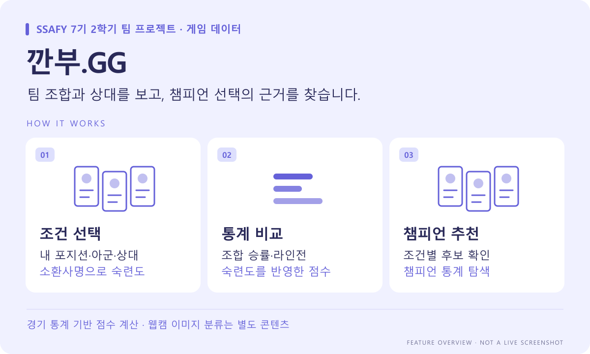

# 깐부.GG

**팀 조합과 상대를 보고, 챔피언 선택의 근거를 찾습니다.**

리그 오브 레전드 경기 데이터를 바탕으로 아군·상대 조합과 포지션에 맞는 챔피언 선택을 돕는 웹 서비스입니다.



**팀 프로젝트 · 2022.08.22–2022.10.07**

### 핵심 기능

- **조건별 챔피언 추천** — 조합 승률을 기본으로 상대 선택 시 라인전, 소환사명 입력 시 숙련도를 반영합니다.
- **경기 통계 조회** — 승률·선택률·밴율과 전투 통계를 조회합니다.
- **게임 콘텐츠** — 스킬 퀴즈·순위 기록, 챔피언 탐색 등 함께 즐길 콘텐츠를 제공합니다.

**기술:** Next.js · Spring Boot · Hadoop · MongoDB

[데이터 처리](#데이터-처리-흐름) · [팀 구성](#팀-구성)

---

<details>
<summary>상세 기능 펼쳐 보기</summary>

## 주요 기능

- **챔피언 추천**: 내 포지션·아군·상대 조합을 입력하면 승률 기준 추천 제공. 같은 포지션의 상대를 선택하면 라인전 추천, 소환사명을 입력하면 숙련도 반영 추천 추가
- **챔피언 통계**: 승률·선택률·밴율, KDA·분당 피해량, 포지션별 경기 수 조회
- **게임 콘텐츠**: 스킬 맞히기와 순위 기록, 웹캠 이미지로 지역 찾기, 궁극기 피하기
- **챔피언 탐색**: 챔피언 정보와 이상형 월드컵


</details>

## 데이터 처리 흐름

```text
Riot Open API
    ↓ Python 수집
Hadoop MapReduce 집계
    ↓ JSON 가공
MongoDB → 추천·통계 API
    ↓
Next.js 웹 화면
```

수집·집계 과정은 [데이터 처리 문서](exec/DataProcessing/%EB%8D%B0%EC%9D%B4%ED%84%B0%20%EC%B2%98%EB%A6%AC%20%EA%B3%BC%EC%A0%95.md)에 정리되어 있습니다.

<details>
<summary>추천 방식과 핵심 코드</summary>

- **승률 추천**: 아군·상대 챔피언과 함께한 경기의 승률을 합산해 순위를 계산합니다.
- **라인전 추천**: 같은 포지션의 상대 챔피언과 비교한 골드 차이와 승률을 사용합니다.
- **숙련도 추천**: 소환사의 챔피언 숙련도를 조합 점수에 반영합니다.

각 추천은 해당 포지션의 선택률이 2% 미만인 후보를 제외하고 최대 5개를 반환합니다. 추천은 경기 통계 기반의 점수 계산이며, 웹캠 이미지 분류는 별도 게임 콘텐츠입니다.

- [화면 입력과 추천 API 호출](frontend/components/championSearchInput/CSInput.js)
- [추천·통계 계산](backend/gganbu/src/main/java/com/ssafy/gganbu/Service/ChampionStatisticsServiceImpl.java)
- [Hadoop 집계 코드](exec/DataProcessing/ProcessMatch2.java)

</details>

<details>
<summary>화면 보기</summary>

### 메인 화면


### 챔피언 추천


</details>

<details>
<summary>기술 스택과 실행 안내</summary>

버전은 저장소의 빌드 설정과 패키지 파일 기준입니다.

| 구분 | 기술 |
| --- | --- |
| 백엔드 | Java 8 대상, Spring Boot 2.7.4, Spring Data MongoDB |
| 프론트엔드 | Next.js 12.2.5, React 18.2.0 |
| 데이터 처리 | Python, Hadoop MapReduce, MongoDB, MySQL |
| 이미지 분류 콘텐츠 | TensorFlow.js, Teachable Machine |

### 저장소 구성

```text
backend/gganbu/        추천·통계 API
frontend/             Next.js 웹 화면
exec/DataProcessing/   수집·집계 코드와 처리 문서
exec/                 시연·빌드·배포 기록
```

### 로컬 실행 명령

DB 연결 정보, Riot API 키, 집계 데이터를 각자 환경에 준비한 뒤 실행합니다. 데이터 수집·집계는 웹 서버 실행과 별도 과정입니다. [API 주소 설정](frontend/api/api.js)의 `HOST`는 당시 서버 주소이므로 실행할 백엔드 주소로 변경해야 합니다.

프론트엔드:

```bash
cd frontend
npm install
npm run dev
```

백엔드 — 별도 터미널:

```bash
cd backend/gganbu
./gradlew bootRun
```

Windows에서는 `./gradlew` 대신 `gradlew.bat`를 사용합니다. 2022년 개발 프로젝트의 코드이며, 새로운 환경에서의 전체 실행은 별도 확인이 필요합니다.

</details>

## 팀 구성

| 역할 | 팀원 |
| --- | --- |
| 백엔드 | 최진욱(팀장), 남현우, 강석민 |
| 프론트엔드 | 최영선, 김지수, 박무창 |

## 관련 문서

- [시연 시나리오](exec/%EC%8B%9C%EC%97%B0%20%EC%8B%9C%EB%82%98%EB%A6%AC%EC%98%A4.md)
- [당시 빌드·배포 기록](exec/%ED%94%84%EB%A1%9C%EC%A0%9D%ED%8A%B8_%EB%B9%8C%EB%93%9C_%EB%B0%8F_%EB%B0%B0%ED%8F%AC.md)
- [기존 프로젝트 소개와 팀 회고](https://github.com/ksmlucky/GGANBU.GG/blob/db91368bb1eb6aaaa2546ca25b30f61a92a266e6/README.md)

> 운영 서비스 주소는 공개하지 않습니다. 소스의 `deployment.example.invalid`는 접속할 수 없는 예시 주소이므로, 실행 시 본인 환경의 서버 주소로 설정하세요.

공개 설정 파일에는 인증값을 포함하지 않습니다. 실행 환경에서 다음 환경변수를 설정하세요: `RIOT_API_API_KEYS`, `SPRING_DATASOURCE_PASSWORD`, `SPRING_DATA_MONGODB_PASSWORD`.
